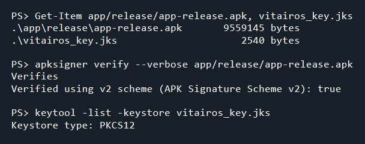

# Vitairos App

Aplicación Android para registrar reportes industriales en terreno, adjuntar evidencias y dar seguimiento a las correcciones solicitadas por supervisión.

## Integrantes

Cristian Diaz

## Funcionalidades

- **Registro en terreno.** El operador selecciona el tipo de reporte, proceso, área y turno. Puede agregar observaciones y registrar su ubicación.
- **Evidencias.** Cada reporte admite hasta cinco archivos JPG, PNG o PDF de hasta 10 MiB cada uno. Se necesita al menos un adjunto para enviar el reporte. La extracción de campos a partir de evidencias es una simulación local del MVP.
- **Trabajo sin conexión.** Después de iniciar sesión, el operador puede guardar borradores en el dispositivo y reintentar los envíos pendientes desde la cola cuando recupere la conexión.
- **Revisión y seguimiento.** El operador consulta su historial y los cambios de estado. El supervisor puede revisar todos los reportes y devolver uno con una nota para que el operador lo corrija y reenvíe.
- **Clima del reporte.** Cuando el servidor recibe por primera vez un reporte con coordenadas, consulta Open-Meteo y guarda la lectura disponible. Si el proveedor falla, el reporte se guarda igualmente.

## Endpoints utilizados

Desde el PC, la base de identidad es `http://localhost:8081/api/v1` y la de reportes es `http://localhost:8082/api/v1`. Las rutas de la tabla se añaden a la base de su servicio. El inicio de sesión devuelve un `accessToken` que se envía en las demás solicitudes mediante `Authorization: Bearer <accessToken>`.

| Microservicio | Método | Ruta | Función |
|---|---|---|---|
| Identidad | POST | `/sessions` | Iniciar sesión con correo y contraseña. |
| Identidad | GET | `/me` | Consultar el perfil y el rol de la sesión. |
| Identidad | DELETE | `/sessions/current` | Cerrar la sesión. |
| Reportes | GET | `/catalog` | Obtener las opciones del formulario. |
| Reportes | GET | `/reports` | Consultar el historial visible para el usuario. |
| Reportes | GET, PUT, DELETE | `/reports/{id}` | Consultar el detalle, guardar cambios o eliminar un borrador propio, respectivamente. |
| Reportes | PUT, GET, DELETE | `/reports/{id}/attachments/{fileId}` | Subir o reemplazar, descargar o eliminar una evidencia. La carga usa el campo multipart `file`. |
| Reportes | PUT | `/reports/{id}/submission` | Enviar el reporte o reenviarlo tras una corrección. |
| Reportes | PUT | `/reports/{id}/correction` | Solicitar una corrección como supervisor mediante el campo `note`. |
| Reportes | GET | `/weather/current?latitude={lat}&longitude={lon}` | Consultar el clima actual de una ubicación. |

**API externa.** El microservicio de reportes llama a `GET https://api.open-meteo.com/v1/forecast` con las coordenadas, las variables meteorológicas y el formato de hora. Esta consulta de ejemplo devuelve temperatura, humedad relativa, velocidad del viento y código meteorológico para un punto de Santiago.

```text
https://api.open-meteo.com/v1/forecast?latitude=-33.45&longitude=-70.66&current=temperature_2m,relative_humidity_2m,wind_speed_10m,weather_code&timeformat=unixtime
```

## Pasos para ejecutar

1. En Windows, inicia Docker Desktop en modo de contenedores Linux. Para compilar la app necesitas Android Studio, JDK 17 y Android SDK Platform 37. El emulador puede ejecutar Android 8.0 (API 26) o superior.

2. Abre PowerShell en la raíz del proyecto. Define las contraseñas de las dos cuentas de demostración y levanta los servicios en esa misma terminal.

   ```powershell
   $env:OPERATOR_PASSWORD = [System.Net.NetworkCredential]::new('', (Read-Host 'Clave del operador' -AsSecureString)).Password
   $env:SUPERVISOR_PASSWORD = [System.Net.NetworkCredential]::new('', (Read-Host 'Clave del supervisor' -AsSecureString)).Password
   docker compose up --build -d
   docker compose ps
   ```

3. Comprueba que `identity-service` y `report-service` aparecen en ejecución en los puertos 8081 y 8082. En Android Studio, abre la raíz del proyecto y espera a que Gradle termine de sincronizar.

4. Inicia un emulador desde **Device Manager**, selecciona el módulo `app` con la variante `debug` y pulsa **Run**. Esta variante accede a los servicios del PC mediante `10.0.2.2`.

5. Entra con `operador@vitairos.demo` o `supervisor@vitairos.demo` y la contraseña correspondiente del paso 2. Para comprobar el flujo, crea un reporte como operador, adjunta una evidencia, envíalo y abre su detalle en el historial.

Para detener los servicios, ejecuta `docker compose stop`. Si prefieres usar un teléfono por USB, sigue el paso 5B de la [guía de arranque](GUIA_DE_ARRANQUE.txt).

## Captura del APK firmado y del almacén de claves (.jks)

El [APK de distribución](app/release/app-release.apk) pasó la verificación de firma APK Signature Scheme v2 con `apksigner`. El almacén de claves se encuentra en la raíz del proyecto con el nombre `vitairos_key.jks`. Su formato interno, verificado con `keytool`, es **PKCS12**.


